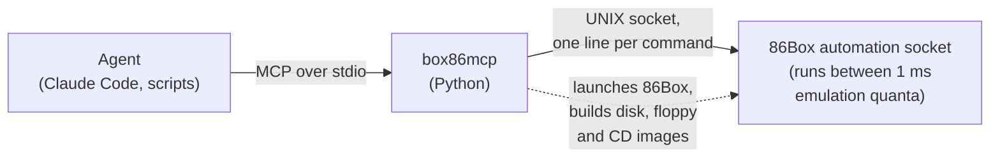

# 86box-mcp

**Let an AI agent, or your test suite, play, test and debug software on a
vintage PC emulated by [86Box](https://86box.net), with emulated time frozen
between moves.**

86box-mcp is an [MCP](https://modelcontextprotocol.io) server that drives an
emulated PC at the hardware level: keys on the emulated keyboard, the emulated
mouse, frames from the emulated video card, physical memory. Nothing runs
inside the guest, so it works from BIOS POST on, in any video mode, under any
OS. Its main targets are DOS games and tools. It runs headless (good for
servers and CI), or with the normal 86Box window if you want to watch.

It is built on an opt-in **automation socket** in 86Box itself, merged upstream
in [#8365](https://github.com/86Box/86Box/pull/8365). It's off by default:
build 86Box with `-D AUTOMATION=ON` to get it.

> **Automating Windows 9x?** Use
> [V9x Remote Agent](https://github.com/michaeldale/V9x-Remote-Agent) instead.
> See [how they compare](#compared-with-v9x-remote-agent).

## Held time

An agent takes seconds to decide what to do; a DOS game runs at 35 or 70
frames per second. In **held** mode no emulated time passes between tool
calls, so a real-time game becomes turn-based:

```
act(hold_keys=["up", "ctrl"], ms=200)   # run forward, firing, for exactly 0.2 s of game time
                                        # → returns the frame at the end of those 0.2 s
```

The agent thinks as long as it needs, and the game never moves without it.
The same control makes runs repeatable: two cold boots driven by the same
inputs produce byte-identical frames and sound, whenever they run. Steps run as
fast as the host allows (about 2× real time for a 486DX2-66 on an older Xeon).

What repeatability rests on:

- **The guest's clock starts from the VM's saved CMOS**, not the host's clock
  (`time_sync = disabled`, in the `[Machine]` section of `86box.cfg`). Before
  2026-10-19 the server wrote it under `[General]`, where 86Box ignores it
  without a warning, so each VM's clock followed the host's and two VMs
  started seconds apart diverged within the first seconds of boot. `vm_start`
  now moves a misplaced `time_sync` where 86Box reads it.
- **Copies of a VM need the same CMOS file as well as the same disk.** 86Box
  saves the CMOS, clock included, when a VM stops, so copy a VM after it has
  stopped and its 86Box has exited.
- **Several VMs in lockstep repeat too.** Two copies of a VM given the same
  input at the same emulated times produced the same samples and the same
  frames through the whole two-minute Warcraft II intro. Packets between VMs
  are the exception: they travel in host time, so networked games repeat
  closely rather than exactly.

## Quickstart

Needs Linux and Python 3.11+. Get the code, and 86Box:

```sh
git clone https://github.com/dafugg/86box-mcp.git && cd 86box-mcp
git clone https://github.com/86Box/86Box.git 86box
```

### Build 86Box natively

Install 86Box's build dependencies. On Debian 13:

```sh
sudo apt install build-essential cmake ninja-build pkg-config \
  qt6-base-dev qt6-base-private-dev qt6-tools-dev qt6-tools-dev-tools qt6-l10n-tools \
  libqt6opengl6-dev qt6-qpa-plugins libvulkan-dev libgl-dev libsdl3-dev libpng-dev \
  libfreetype-dev libopenal-dev librtmidi-dev libfluidsynth-dev libsndfile1-dev \
  libslirp-dev libserialport-dev libevdev-dev libxkbcommon-x11-dev libx11-dev \
  libwayland-dev libzstd-dev libedit-dev libxcb-cursor0 qt6-wayland mtools
```

`qt6-wayland` is only for `vm_start(window=True)` on a Wayland desktop: with
it, 86Box opens a native Wayland window; without it, Qt falls back to
XWayland, if `DISPLAY` is set.

Then build with the automation socket enabled:

```sh
cmake -G Ninja -S 86box -B 86box/build-mcp -D CMAKE_BUILD_TYPE=Release \
  -D QT=ON -D USE_QT6=ON -D AUTOMATION=ON -D DISCORD=OFF -D MUNT=OFF -D SOUNDCANVAS=OFF
cmake --build 86box/build-mcp
```

On Ubuntu 24.04, which has no SDL3, install `libsdl2-dev` instead of
`libsdl3-dev` and add `-D SDL2=ON`. We've tested that build outside any
container: the test suite and the MCPDEMO driver's 34 checks pass. That test
unpacked Ubuntu's packages into a private prefix rather than installing them,
and it had no display, so it didn't try `vm_start(window=True)`.

The server uses `86box/build-mcp/src/86Box` automatically when that build has
the automation socket; set `BOX86_BINARY` to use a build somewhere else.

### Or build and run 86Box in Docker

If you can't install those packages (no root, or a distribution without Qt6
or SDL3), Docker does the build and runs 86Box in a Debian container:

```sh
docker/build.sh       # builds the image and 86Box into .cache/build
```

The server uses the Docker wrapper `docker/86box.sh` whenever there's no
native build. One constraint: VM directories and media must be under `$HOME`
or `/tmp`, because those are the only paths mounted into the container.

This is how we develop it. Our build machine has no root access, so we can't
install the packages, and upstream's AppImage packaging was broken when we
tried it. The container gives a reproducible Debian toolchain on any host.
Any 86Box built with `-D AUTOMATION=ON` works; official releases are built
without it.

### Or run 86Box on Windows

`docker/windows/build.sh` cross-compiles 86Box for 64-bit Windows in a
Fedora container (MinGW, Qt6, SDL3; [details](docker/windows/README.md)) and collects the DLLs into
`.cache/win64/86Box-automation-win64/`. Start it on Windows with
`--automation tcp:7086`. It writes a token file and serves on `127.0.0.1`
unless you also pass `--automation-allow-remote`, so read
[Choosing a transport](#choosing-a-transport) first. Then connect from the MCP
server with `vm_attach("tcp:<windows-ip>:7086", "<token>")`.

### Or run everything on Windows

The MCP server also runs natively on Windows, next to a Windows 86Box. A
user has run it on Windows 11, without WSL, through its own `VM` class and
through Claude Code over MCP: boot, held steps, typing, the text screen,
screenshots, memory, registers and `window=True`. We haven't tested it on
Windows ourselves yet.

1. **86Box with the automation socket:** cross-compile it with
   `docker/windows/build.sh` as above, or build it in MSYS2 (MinGW64):
   `cmake -S . -B build -G Ninja -DCMAKE_BUILD_TYPE=Release -DQT=ON -DAUTOMATION=ON`.
2. **The server:**
   ```bat
   py -3.12 -m venv server\.venv
   server\.venv\Scripts\python -m pip install -e server
   ```
3. **Register it with your agent**, with `BOX86_BINARY` pointing at
   `86Box.exe`, and with the folder holding its DLLs on `PATH` (for an MSYS2
   build, `C:\msys64\mingw64\bin`). For example:
   ```bat
   claude mcp add 86box -e BOX86_BINARY=C:\86Box\86Box.exe ^
       -e "PATH=C:\msys64\mingw64\bin;C:\Windows\System32;C:\Windows" ^
       -- C:\86box-mcp\server\.venv\Scripts\box86mcp.exe
   ```

On Windows the server talks to 86Box over TCP on `127.0.0.1`, with a token
(there are no UNIX sockets). `vm_start` shows the normal 86Box window by
default there; pass `window=False` to run headless, or set `BOX86_WINDOW=0`
to make that the default (`BOX86_WINDOW=1` shows it on other systems). The
DOS disk tools (`dos_create_vm`, `dos_install_files`, `dos_put_floppy`) need
mtools (`mformat`, `mcopy`, `mmd`, `mattrib`) on `PATH` or in
`BOX86_MTOOLS_DIR`; MSYS2 has a `mtools` package. Recordings need `ffmpeg`
on `PATH`. `python -m box86mcp.ctl` listens on loopback TCP, with a token in
an owner-only file. The debugger tools need 86Box built with `-DGDBSTUB=ON`.

### Connect your agent

```sh
python3 -m venv server/.venv && server/.venv/bin/pip install -e 'server[test]'
claude mcp add 86box -- "$PWD/server/.venv/bin/box86mcp"
```

The server's Python package is called `box86mcp`, not `86box_mcp`, because
Python names can't start with a digit. The package, its command and its
`BOX86_*` settings all use that name. Agents see the server as `86box`.

You also need the [86Box ROMs](https://github.com/86Box/roms). Put them where
86Box looks for them, such as `~/.local/share/86Box/roms`, or point
`BOX86_ROMS` at them.

For the DOS helpers you also need `mtools` on your `PATH`, and a bootable DOS
hard disk image to take the system files from: pass it to `dos_create_vm` or
set `BOX86_DOS_BASE_IMG`. Without one, install FreeDOS from its floppies as in
the examples.

The tests that boot DOS need that image too, as `BOX86_TEST_BASE_IMG`, and are
skipped without it.

**Give your agent the skill.** [`.claude/skills/86box`](.claude/skills/86box/SKILL.md)
teaches an agent how to use the server well: when to run held or in real
time, how to install software, play real-time programs, compare 86Box builds,
use the debugger and work alongside V9x, and the usual pitfalls. Claude Code
picks it up by itself in this repo. Elsewhere, copy it into your skills:

```sh
cp -r .claude/skills/86box ~/.claude/skills/
```

Then ask your agent something like:

> Create a DOS VM in ~/vms/test, install ./build/GAME.EXE to C:\GAME, boot it,
> start the game and get to the main menu.

## Examples

Everything below was driven through the MCP tools and recorded by 86Box
itself. The GIFs are short excerpts; `python -m box86mcp.ctl render-timeline` turns a
recording into a full video captioned with the MCP call in progress.

### Playing games

#### Learning Solitaire


Claude's first real game in Windows 3.11. The yellow line narrates its genuine
mistakes as they happen. It aims at a menu inside the corner where `mouse_to`
parks the pointer. A drag gets thrown off the window by Windows' mouse
acceleration. `mouse_to` chases the game clock. Finally, a strategy mistake
loses the game (score 8).


After researching Klondike strategy (uncover hidden cards first; only empty a
column for a king that unlocks something), it wins with a score of 2600. Most
of that is Solitaire's time bonus. In held mode the game clock only runs while
the agent acts, not while it thinks.

#### Playing Solitaire for score: 24,024


Next, Claude was asked for the highest score it could get. It wrote a bot,
[`examples/solitaire`](examples/solitaire), on top of this project's Python
client, and it scored **24,024**. The best possible is about 24,072. A human
needs minutes to play a game, so typical scores are a few thousand.

How the score works: Windows 3.1 Solitaire adds a bonus of 700,000 ÷ seconds
for a win, but only for wins of 30 s or more. Each move scores a few points. So
the bot plays all 52 cards up as fast as the mouse allows, then holds the last
card until Solitaire's own clock reads 30. Recycling the waste costs 100
points, so the best games never recycle.

The bot builds on two parts of this project:
- **Held time:** the emulator stops between actions, so recognising cards,
  checking the screen and choosing a move take no game time.
- **Exact input:** pointer acceleration is off in the VM, so one mouse count
  moves the pointer exactly one pixel. The bot can jump straight to a card,
  sending moves in pieces no faster than Windows reads the mouse.

The bot also:
- recognises cards from their corners (all 52 labelled once from contact
  sheets);
- keeps a model of the table, and checks it against the screen after every
  move;
- reads the score and clock off the status bar.

Building it took a few rounds of fixes. One fix was for a double-click that
nobody meant: a click to turn a card over, then a grab at the same spot. Then
it played 50 recorded games, won 19 and kept the two best. Two wins never
recycled the waste, and both beat 24,000:


Run it with `python examples/solitaire/play.py <games> [--minutes N]`. The bot
needs a Windows 3.11 VM at 640×480 with Solitaire set to Draw One, the status
bar on, and the mouse at its slowest speed. The labelled card corners are in
`examples/solitaire/lib`. If your cards look different, `solbot.py collect`
gathers new corners on a contact sheet for labelling.

#### SkiFree: the maximum score, 32,767


[`examples/skifree`](examples/skifree) plays the original 16-bit SkiFree 1.0
in Windows 3.11. The bot reads the game's state from guest memory every tick
and plays with the keyboard while time is held.

In Freestyle it scored **32,767**, the largest value SkiFree's 16-bit score
can hold, and skied across the finish line into the High Scores box:
- **Finding the rules:** a [decompilation of the later 32-bit
  version](https://github.com/yuv422/skifree_decomp), checked against 1.0 in
  memory.
- **The trick:** a backscratcher scores 8 points for every tick in the air,
  and you can hop from a standstill. So the bot hops in place all the way down
  the course, mixing in uphill steps so the hops don't drift it off the end.
- **The finish:** it chose each tick's trick to land exactly on the limit.

Another run outran the Abominable Snowman. Turbo skiing is faster than he
is, so the bot plans its lane a screen ahead to avoid crashing. It kept going
until the distance wrapped round (y is a 16-bit number, and past 2,047 m the
distance shows as negative), and came back onto the course for a second lap.
Here it crashes just after the wrap, and gets up and away before he reaches
it:


#### Arkanoid II: 386,920 points


[`examples/arkanoid`](examples/arkanoid) plays the 1989 DOS version of
*Arkanoid II: Revenge of DoH* on MS-DOS 6.22. Every frame (about 14 ms), the
bot reads the paddle, the balls, the falling capsules and the score from guest
memory, then steers with the keyboard while time is held. Its best game scored
386,920 and reached round 10:
- **Prediction:** it works out where each falling ball will meet the paddle,
  bouncing off the walls, and gets there early. The paddle is only about as
  fast as the ball.
- **Aiming:** where the ball hits the paddle sets its new angle. The bot cycles
  through eight hit positions, so successive bounces sweep the field and reach
  the last bricks.
- **Capsules:** these are worth 1,000 points each. The bot catches them while
  the ball is heading up, which more than tripled its scoring rate.

Two lessons from getting it going:
- **The demo:** after a game ends, the game's attract-mode demo takes over and
  plays itself, which is easy to mistake for the bot playing.
- **The keys:** the game only reads the keypad keys, not the extended arrow
  keys.

#### Warcraft II over IPX: two VMs in lockstep


Two DOS machines in one server, linked by 86Box's network switch, play
Warcraft II over IPX. Alpha's peon walks to Bravo's base and kills Bravo's
peasant. Both machines are held, and every tool call that passes time on one
passes the same time on the other, 10 ms at a time, so neither game sees its
peer stall. `record_stop_all` rendered the video, with both screens on their
shared emulated clock. See [`examples/warcraft2`](examples/warcraft2).


Then eight. All eight VMs boot from power-on and join one game on
`plots.pud`. Each peon walks to a ring round one tile, on routes planned from
the map's terrain and sent leg by leg. Then every peon attacks its clockwise
neighbour in the same instant. Five Defeat screens follow within ten seconds,
and after some fumbling by the agent, left in, Foxtrot is the last one standing.
Clicks go through MOUSEBOX, which puts the pointer where `mouse_to` says,
however the game reads the mouse. What the game taught us about input is in
[docs/input-quirks.md](docs/input-quirks.md), and the run itself in
[`examples/warcraft2`](examples/warcraft2#eight-players).

#### Warcraft II over a null-modem cable


The same two machines, without the network: `serial_link` joins their COM1
ports with a null-modem cable, and they play a Direct Connect game. Alpha
calls, Bravo answers, they chat in the lobby, and Bravo surrenders. Each
byte crosses the cable between lockstep quanta and reaches the other guest at
its own baud rate, all in emulated time, so two runs give the same bytes both
ways and the same final screens. See
[`examples/warcraft2`](examples/warcraft2#over-a-null-modem-cable).

#### Telix and a BBS through an emulated modem


Telix 3.51 in DOS dials `555-1234` on COM1. `serial_attach` puts a Hayes modem
there, which connects the call over TCP to a small BBS on the host
([`examples/telix/fakebbs.py`](examples/telix)). The session logs in, echoes
lines, captures 200 lines to a file, downloads a file by XMODEM-CRC and
XMODEM-1K, uploads it back, and hangs up by dropping DTR. Every file came out
byte for byte. See [`examples/telix`](examples/telix).

### Development and testing

#### A demo game with readable memory state


[`examples/mcpdemo`](examples/mcpdemo) is a small DOS game. The GIF shows
its driver testing keys, `mouse_to`, `write_memory` and timing, then a
~20-line bot playing with one `act()` call per frame. Every tick it publishes its
state to a block in conventional memory: player, enemy, coin and pointer
positions, score, lives, keys held. A pointer at `0000:04F0` says where the
block is. Tests read it with `read_memory` and `wait_for_memory` instead of
guessing from pixels, and can even post commands back into the block with
`write_memory`. The driver checks 34 exact results this way, including
movement per key press, mouse placement, COM1 logs and real-time vs held
timing. Publish a block like this in your own program and the same tools work
for it.

#### Installing FreeDOS from floppies


From a blank 512 MB disk: the installer partitions it; Award BIOS setup is
changed to boot from A: first; then format, six floppies, and a boot from C:.
Afterwards FreeDOS's CD driver reads a disc built by `cdrom_insert`.

#### Installing Windows for Workgroups 3.11


On MS-DOS 6.22: Setup's DOS stage, then its GUI with the buttons clicked by
`mouse_to`. Three dialogs hide the pointer, so those took keys. Then `WIN`,
and a quick Solitaire.

#### Windows 98 with V9x: two views of one machine


[`examples/v9x`](examples/v9x) installs Windows 98 and
[V9x Remote Agent](https://github.com/michaeldale/V9x-Remote-Agent) into one
VM, and drives it through both MCP servers at once.
[`crossover.py`](examples/v9x/crossover.py) checks 17 combinations, such as
V9x opening a file in Notepad while `find_memory` finds its text in RAM. All
17 behaved as expected.
[`hwview.py`](examples/v9x/hwview.py) takes two inventories of the PC and
matches them. 86box-mcp scans the PCI bus through the debugger, from outside.
V9x exports Windows' Plug and Play tree (`HKLM\Enum`), from inside. All four
PCI functions matched a Windows device at the same bus, device and function,
and the ISA PnP NE2000 was found as an RTL8019. The SB16, which isn't Plug and
Play, was never detected: Device Manager has no sound category. That's the
kind of mismatch to look for when you emulate a device. See
[the example's README](examples/v9x/README.md) for the setup and
[driver development](docs/driver-development.md) for the debugger.

#### Benchmarking 86Box releases: 3DMark 99 on a Voodoo 2


[`bench/`](bench/) is a tool for 86Box developers. It runs one or more 86Box
builds through the same workload: Windows 98 boots, then 3DMark 99 MAX's full
benchmark runs on a 3dfx Voodoo 2. Each run starts from a pristine copy of a
prepared disk image, and the tool reports three things.

- **Reliability:** every phase finished, with no resets.
- **Speed:** emulated seconds per wall second. The boot and the benchmark run
  held, stepping as fast as the host allows, so the number isn't capped by
  real-time pacing.
- **3DMark's own results**, which it measures in emulated time, so they
  reflect the emulation.

`pytest bench/` turns a run into pass/fail checks for CI.

Comparing current master with a build from before the old recompiler's
removal, it found:

- The older build crashes (`fatal("Over limit!")`) when 3DMark's Result
  Browser starts, and runs the benchmark about 20 % slower.
- On a fatal error the automation socket went silent instead of closing
  ([86Box#8392](https://github.com/86Box/86Box/pull/8392)).
- The emulated Voodoo 2 has no speed of its own: it runs as fast as 86Box's
  render threads draw on the host. Fill rate doubles with twice the threads,
  while CPU 3DMarks stays within 0.2 %. So the Voodoo-bound results benchmark
  86Box's renderer on the host, rather than the emulated card.

See [bench/README.md](bench/README.md).

## Tools

These work with any guest OS:

| Tool | What it does |
|---|---|
| `vm_create`, `vm_start`, `vm_stop`, `vm_status`, `vm_info` | New VM with a blank disk (512 MB CompactFlash geometry by default), as a 486DX2-66 or a copy of any `86box.cfg` you pass as `config`, with an optional saved CMOS (`nvr`); boot (held by default; `window=True` to watch; without `vm_dir`, the last VM started, or `$BOX86_VM_DIR`); power off, or press the power button and let the guest shut down (`soft=True`); status; machine, CPU, RAM, media, speed and reset counts (a triple fault shows up there) |
| `hold`, `release`, `step(ms)`, `fast_forward` | Freeze time, run in real time, or run exactly *ms* of emulated time; `fast_forward(True)` lets a released machine run as fast as the host allows |
| `measure_speed(seconds, paced)` | Emulated seconds per wall second: paced (does it keep up with real time?) or unpaced (throughput, to compare 86Box builds, each started with `vm_start(binary=...)`) |
| `act(hold_keys, ms)` | Hold keys for *ms*, release, return the frame: one game turn |
| `press_keys`, `type_text` | Keyboard |
| `mouse`, `mouse_to(x, y)`, `mouse_drag`, `mouse_state` | Relative motion, with buttons (`release=False` keeps them down); put the pointer at a screen position (closing the loop on where it lands, or directly through MOUSEBOX in DOS, [examples/touch](examples/touch)); drag; how a DOS program reads the mouse |
| `tablet(x, y)` | Touch the screen at a pixel: absolute input, for a VM with 86Box's MicroTouch touchscreen and a touch driver in the guest ([examples/touch](examples/touch)) |
| `together(actions)` | Input to several VMs at the same emulated instant, different for each if you like |
| `vm=` on any tool, `vm_list`, `vm_group`, `step_all`, `hold_all`, `release_all`, `record_stop_all` | Several VMs in one server, by name. Held VMs in a group (all of them, by default) step together in lockstep, whichever one a tool acts on, so networked guests stay in sync; `record_stop_all` renders their recordings side by side on the shared emulated clock, with one VM's sound, a mix, or each VM on its own side of the stereo image (`audio="split"`); `sync=True` shows each frame's block, CPU cycles, sound sample position and picture and sound hashes under each VM, and compares the VMs frame by frame |
| `screenshot`, `screen_text`, `wait_for_text` | The frame; text-mode screen as text; run until text appears |
| `read_memory`, `write_memory`, `wait_for_memory`, `registers`, `fpu_registers` | Physical memory, limited to the emulated RAM (`vm_info` reports `mem_kb`); CPU registers, including control, debug and descriptor-table registers and segment caches, and the x87/MMX registers (these need 86Box [#8416](https://github.com/86Box/86Box/pull/8416)) |
| `descriptor_table`, `translate_address`, `read_memory(linear=True)` | Protected-mode debugging: decode the GDT, LDT or IDT; follow selector:offset to linear to physical through the page tables (32-bit, 4 MB pages, PAE); read memory as the CPU sees it with paging on ([examples/protected-mode](examples/protected-mode); needs 86Box [#8416](https://github.com/86Box/86Box/pull/8416)) |
| `find_memory`, `snapshot_memory`, `diff_memory` | Search memory for bytes, text or a number; snapshot it, then keep only the addresses that changed the way you expect (increased, decreased, equal to a value) to find a game's variables |
| `serial_read`, `wait_for_serial`, `serial_write` | A COM port both ways, in emulated time, for a VM started with `vm_start(serial=[1])` (any of COM1-4): what the guest sent, run until it sends some text, send it bytes (they arrive at the guest's baud rate). On an older 86Box, COM1 output only (`com1_log=True`) |
| `serial_link`, `serial_attach`, `serial_status` | What's on the other end of the line: a null-modem cable to another VM (`serial_link`, for serial games and file transfer), or on the host a Hayes modem that dials TCP addresses, a TCP socket or a pty (`serial_attach`); bytes moved and line states |
| `floppy_insert`, `floppy_eject`, `cdrom_insert`, `cdrom_eject` | Swap media while running; `cdrom_insert` can build an ISO from host files |
| `record_start`, `record_stop`, `reset` | Record a frame every N ms of emulated time (1: every frame the guest shows), with sound; render a video with its sound on the same clock; hard reset or Ctrl+Alt+Del |
| `sound_level`, `wait_for_sound`, `wait_for_silence`, `sound_spectrogram`, `sound_save`, `sound_check` | Needs an 86Box from 2026-10-20 or later (see limitations). Sound, for an agent that can't listen: how loud each stream is; run until a sound starts or stops (to about 1 ms); a spectrogram image with the dominant frequencies; a WAV for a person; a recording checked for dropouts and missing samples |
| `breakpoint_set`, `run_until_break`, `step_instructions`, `debug_continue` | With `vm_start(debugger=True)` and 86Box built with `-D GDBSTUB=ON`: execution breakpoints and memory watchpoints, single instructions, all while held |
| `io_read`, `io_write`, `pci_scan`, `pci_config_read` | Also with the debugger: port I/O as the CPU would do it, and PCI configuration space |

Programs read the mouse and keyboard in different ways, and input that works in one can fail in another: [docs/input-quirks.md](docs/input-quirks.md) lists what we've found, program by program.

DOS helpers assume DOS and FAT disks: `dos_create_vm` (VM with a bootable DOS
disk; takes `config` and `nvr` like `vm_create`), `dos_install_files` (copy files of any size onto C: while stopped),
`dos_put_floppy` (hot-insert a floppy with some files) and `dos_run` (type a
command and wait for the prompt).

The debugger tools are for developing drivers and device emulation; see
[docs/driver-development.md](docs/driver-development.md), which also lists
what else would help and what it would take in 86Box.

`python -m box86mcp.ctl` drives the server from a shell, one call at a time,
and renders recordings into captioned videos; that's how the examples were
made.

## Tips for Windows 3.x

Learned the hard way, as the first Solitaire game shows:

- **Turn off mouse acceleration first:** Control Panel > Mouse > Mouse Tracking
  Speed to Slow (with the keyboard: End, not Home). Otherwise the pointer gain
  depends on speed and drags overshoot.
- **Keep the screen still while `mouse_to` measures.** It finds the pointer by
  comparing frames and ignores blinking carets. A clock ticking once a second
  (Solitaire's status bar) can still fool it, so hide it.
- **Use the keyboard for the top-left 32 px**, where `mouse_to` parks the
  pointer, and for dialogs that hide the pointer (Windows Setup has some).
- **Double-click** with two quick `mouse(left=True, hold_ms=40)` calls.

## Compared with V9x Remote Agent

Both projects let an agent drive a vintage PC over MCP. They sit at different
layers, and each is strong where the other is weak.

| | **86box-mcp** | **[V9x Remote Agent](https://github.com/michaeldale/V9x-Remote-Agent)** |
|---|---|---|
| Where it runs | Outside the machine, inside 86Box | Agent program inside the guest OS |
| Guest software needed | None | Agent installed in the guest, plus a network card |
| Guest OS | Any, including bare DOS, games, BIOS setup and OS installers | Windows 95/98/Me/2000 (DOS build: commands and files only) |
| Real retro hardware | No (patched 86Box only) | Yes |
| Emulated time | Hold, exact steps, turn-based play | Runs in real time |
| Screenshots and input | Any video mode, hardware-level input | Windows desktop (needs Explorer) |
| Commands, exit codes, file transfer | Typed at the DOS prompt; files via disk images | Native: run with exit codes, CRC-verified transfer, reboot handling |
| Memory and registers | Yes | No |
| Host | MCP server on Linux; 86Box on Linux, or on Windows driven over TCP; macOS untested | Windows CLI; MCP server on Windows/macOS/Linux |
| License | GPL-2.0-or-later | BSD-2-Clause |

**Rule of thumb:** to develop or automate **Windows 9x** software, use V9x
Remote Agent. For **DOS** games and programs, real-time or graphics-mode
software, deterministic tests, OS installs, or anything that happens before an
OS is up, use 86box-mcp.

### Using both at once

They do combine: one Windows 98 VM runs the V9x agent, and an agent uses both
MCP servers side by side. [examples/v9x](examples/v9x/) has the setup steps
and `crossover.py`, which runs 17 crossover checks. All 17 behaved as
expected.


- **Works together:** V9x opens a file in Notepad and `find_memory` finds its
  text in physical RAM. `type_text` types into a window and V9x saves and
  fetches the file. `v9x_move` places the pointer, `mouse` moves it, and V9x
  reads it back. `cdrom_insert(files=...)` builds a disc and V9x lists it.
  `reset(kind="hard")` reboots and `v9x_wait_desktop` sees the new boot. The
  two screenshots agree, except for the pointer.
- **The catch is time.** V9x is a TCP server inside the guest. While
  86box-mcp holds the machine, nothing in the guest runs, so V9x calls time
  out. `release` while you use V9x, or send a V9x call while a `step` runs:
  the call completes inside the step, and the machine stays held after it.
- **Pace V9x calls.** The agent takes 4 connections at most, and calls sent
  while the machine is held pile up. See
  [pacing](examples/v9x/README.md#pacing-v9x-calls-around-held-time).
- **Two views of one machine:** `hwview.py` matches 86box-mcp's PCI scan
  with Windows' own device tree, fetched by V9x. Every PCI function matched;
  the non-PnP SB16 was never detected.
  [Details](examples/v9x/README.md#the-hardwares-view-against-windows-view).
- **Don't overlap:** 86box-mcp's disk tools need the VM stopped. Use
  `v9x_put_file` while Windows runs, and `screen_text` only reads text modes.

If you're on DOSBox rather than 86Box, look at
[dosbox-mcp](https://github.com/dosbox-automation/dosbox-mcp), which pairs an
MCP bridge with a DOSBox fork. 86Box emulates specific period hardware (real
chipsets, BIOSes, video and sound cards), which matters when you're testing
software meant to run on an actual machine.

## How it works



The automation socket (`86Box --automation <path> [--automation-hold]`) is a
line protocol you can also use from scripts or `socat`. See
[`doc/specifications/automation.md`](https://github.com/86Box/86Box/blob/master/doc/specifications/automation.md)
in 86Box. [docs/automation-code-guide.md](docs/automation-code-guide.md) walks
through the code, and [TODO.md](TODO.md) lists what's still open.

## Choosing a transport

86Box serves the automation protocol on a UNIX domain socket or on TCP:

```sh
86Box --automation unix:/tmp/86box.sock ...                               # Linux, macOS
86Box --automation tcp:7086 --automation-token-file /tmp/86box.token ...  # TCP on 127.0.0.1
```

The MCP server picks for you: a UNIX socket on Linux and macOS, TCP on
Windows. Set `BOX86_TRANSPORT=tcp` or `unix` to override.

**Use the UNIX socket unless you can't.** It's owner-only, so only your user
can connect, and it isn't on the network at all. Any process on the machine
can connect to a TCP port, so TCP always requires a per-run random token,
written to an owner-only file, which the client sends first. It also binds
only to `127.0.0.1`. 86Box refuses other addresses unless you add
`--automation-allow-remote`. Even then, think twice: the protocol is
unencrypted, and whoever reaches the port with the token fully controls the
emulated machine, memory included. The design follows
[dosbox-automation's](https://dosbox-automation.org/0.85.1/automation/security/index.html).
Details are in the [protocol doc](https://github.com/86Box/86Box/blob/master/doc/specifications/automation.md#transports-and-security).

> [!CAUTION]
> **Never connect a machine running 86Box with `--automation-allow-remote` to
> the internet**, nor to any network you don't fully trust, and never forward
> its automation or GDB stub port through a router. The protocol is
> unencrypted, so the token can be read off the wire, and the GDB stub has no
> authentication at all. Whoever gets in controls the emulated machine and,
> through it, can read any file 86Box can open and write files on the host
> (see [Insecure mode](#insecure-mode)). To reach 86Box from elsewhere, use an
> SSH tunnel ([below](#86box-on-another-machine)).

### 86Box on another machine

`vm_attach` drives an 86Box that was started elsewhere, by hand or by a
script. Most tools work the same over the connection:

- **Input, screens, memory, registers, waits, lockstep groups and serial
  ports** all go through the automation socket.
- **Recordings** (frames and sound) come back over the connection, and
  `record_start`'s directory is on the MCP server's machine.
- **Media:** an image file on the MCP server's machine, given to
  `floppy_insert` or `cdrom_insert`, is sent to 86Box first. That includes a
  `.cue` and its tracks, and the images that `dos_put_floppy` and
  `cdrom_insert(files=...)` build. 86Box keeps the copies in its VM
  directory's `automation-media` folder. A path that isn't a file here is
  taken as a path on 86Box's machine. If the guest writes to a floppy, it
  changes 86Box's copy, not yours.
- **`vm_status`'s log tail** comes from 86Box over the connection, and so
  does the message when 86Box stops with a fatal error.
- **The debugger** connects to the GDB stub on the endpoint's host, at the
  port 86Box reports, or at `vm_attach(gdb_port=...)`.

These need an 86Box from 2026-10-22 or later, with
[86Box#8466](https://github.com/86Box/86Box/pull/8466) (merged): sending
media, the log, fatal errors and the stub's port. Without them,
media paths are paths on 86Box's machine, there's no log tail, and the
debugger assumes the stub's default port, 12345.

Some tools only work where the MCP server runs:

- `vm_create`, `dos_create_vm`, `dos_install_files` and `vm_start` work on VM
  folders on the MCP server's own machine. To get a VM onto 86Box's machine,
  copy its folder there once 86Box has exited, since it saves the CMOS when
  it exits.

Neither the automation socket nor the GDB stub is encrypted, and the stub has
no authentication at all: it listens on every interface, so firewall its port.
Rather than `--automation-allow-remote`, keep 86Box on `127.0.0.1` and tunnel
both ports over SSH:

```sh
ssh -N -L 7086:127.0.0.1:7086 -L 12345:127.0.0.1:12345 user@86box-host
# then: vm_attach("tcp:127.0.0.1:7086", "<token>")
```

Every `step`, `wait` and key press is a round trip, and a lockstep group
makes one per quantum (10 ms by default). On a LAN that doesn't matter. Over
a link with a 50 ms round trip, a group runs at about a fifth of real time,
and a larger `vm_group(quantum_ms=...)` helps.

### Between your agent and the MCP server

By default the MCP server talks to its client over stdio, as a child process.
For clients that connect over HTTP instead, set `BOX86_MCP_HTTP_PORT`: the
server then serves MCP's streamable HTTP transport at
`http://127.0.0.1:PORT/mcp`. For HTTPS, also set `BOX86_MCP_TLS_CERT` and
`BOX86_MCP_TLS_KEY` to a PEM certificate and its key:

```sh
BOX86_MCP_HTTP_PORT=8443 BOX86_MCP_TLS_CERT=cert.pem BOX86_MCP_TLS_KEY=key.pem box86mcp
# -> https://localhost:8443/mcp
```

Either way it listens only on `127.0.0.1`, with the MCP library's DNS-rebinding
protection (only `localhost` hosts and origins). There is no authentication:
any local process can connect and drive the VM, and through `vm_create` and
the disk tools, read and write files as you.

### Insecure mode

For a machine and network you trust, `BOX86_INSECURE=1` drops the
protections that get in the way of simple setups, the way 86Box's GDB stub
already works:

- **86Box's automation socket** over TCP (`BOX86_TRANSPORT=tcp`, the default
  on Windows) runs without its token: the server starts 86Box with
  `--automation-insecure`, and `vm_attach` connects to any 86Box started that
  way without one. Any local process can then use everything the protocol
  offers, and with `--automation-allow-remote` so can anyone who can reach the
  port:
  - drive the VM, read and write its memory, reset it and power it off;
  - load any file 86Box can open, as a floppy or CD image, and read it
    through the guest: your documents and keys as well as disk images;
  - write files into the VM folder's `automation-media` directory
    (`media put`, [86Box#8466](https://github.com/86Box/86Box/pull/8466)),
    as many and as large as they like, until the disk is full.
- **The MCP server's HTTP transport** may listen on any address, set with
  `BOX86_MCP_HTTP_HOST` (for example `0.0.0.0`), without the DNS-rebinding
  checks. Anyone who can reach that port can drive the VM and, through the
  server's tools, **read and write files on this machine as you**. HTTPS
  (above) encrypts the connection, but doesn't authenticate the client.

Insecure mode doesn't hold any of this back: it is for a single-user machine,
or a private network where you trust every device. **Never use it with
`--automation-allow-remote` or a non-loopback `BOX86_MCP_HTTP_HOST` on a
machine connected to the internet.**

Without `BOX86_INSECURE=1`, a non-loopback `BOX86_MCP_HTTP_HOST` is refused.
`--automation-insecure` needs an 86Box with
[86Box#8397](https://github.com/86Box/86Box/pull/8397).

## Status and limitations

This is an early release, built for developing our own DOS games and tools.

- **86Box must be built with `-D AUTOMATION=ON`.** The automation socket is in
  upstream 86Box, but official releases are built without it.
- **Windows: best effort, untested by us.** 86Box with the automation socket
  has been built for 64-bit Windows and driven over TCP from Linux with
  `vm_attach`. The MCP server itself has been run natively on Windows 11 by a
  user (see [Or run everything on Windows](#or-run-everything-on-windows)), and
  its Windows code paths (stopping 86Box, `window=True`, the `ctl` CLI) follow
  that report. The disk tools, the debugger and the stop fallback haven't run
  on Windows. macOS hasn't been tried at all.
- **Mouse input is relative.** (See [Tips for Windows 3.x](#tips-for-windows-3x).) DOS and Windows 3.x drivers only understand
  relative mice, so `mouse_to` closes the loop. It reads the pointer from
  memory if your program publishes it, or finds it on screen. On screen it
  needs the pointer to be visible: some programs hide it (Windows 3.11 Setup
  does in its keyboard-driven dialogs), and busy animation can mask it.
  86Box's absolute devices (tablets, touchscreens) need guest drivers that
  these systems don't ship.
- **The debugger needs an 86Box from 2026-10-18 or later**, with
  [86Box#8390](https://github.com/86Box/86Box/pull/8390) and
  [86Box#8391](https://github.com/86Box/86Box/pull/8391) (both merged). Without
  them, the GDB stub can't answer while the machine is held, and memory
  watchpoints on RAM don't fire. See
  [docs/driver-development.md](docs/driver-development.md#setting-up-the-debugger).
- **Sound, and recordings of a VM on another machine, need an 86Box from
  2026-10-20 or later** (`86BOX_MIN_COMMIT` or newer), with
  [#8419](https://github.com/86Box/86Box/pull/8419),
  [#8420](https://github.com/86Box/86Box/pull/8420) and
  [#8421](https://github.com/86Box/86Box/pull/8421) (all merged). With them,
  recordings and videos carry the guest's sound on the emulated clock, the
  sound tools measure it, and frames and sound come over the automation
  connection, so `vm_attach` over TCP records here too. On an older 86Box,
  recordings are silent and their frames are written on 86Box's machine. The
  sound cards, OPL and the PC speaker are sample-exact. CD audio, the floppy
  and hard-disk sounds and the MIDI synths (MT-32, FluidSynth) are rendered on
  86Box threads, so they are dated by when each block arrives, within one
  block (20-100 ms). Nothing can be sent to the guest's line-in or microphone
  yet, and MIDI sent to a host MIDI device isn't captured.
- **Serial ports need an 86Box from 2026-10-20 or later** (`86BOX_MIN_COMMIT` or
  newer), with [#8439](https://github.com/86Box/86Box/pull/8439) (merged), for
  input to the guest, COM2-4, links and modems. On an older 86Box, the guest's
  writes to COM1 can still be read through a file (`vm_start(com1_log=True)`,
  off by default). It used to look like that made runs occasionally
  non-reproducible (about 2 in 6). Likelier causes have since turned up: disk
  images that recorded the host's clock, and the guest's clock following the
  host's (see repeatability, above). With the first fixed, 40 of 40 runs with
  COM1 capture on were identical.
- **The parallel ports aren't reachable** from the server (printers,
  parallel-port devices). 86Box's own port options (a file, a host serial
  port, a named pipe) still work if set in `86box.cfg`.

## License

GPL-2.0-or-later, the same as 86Box.
